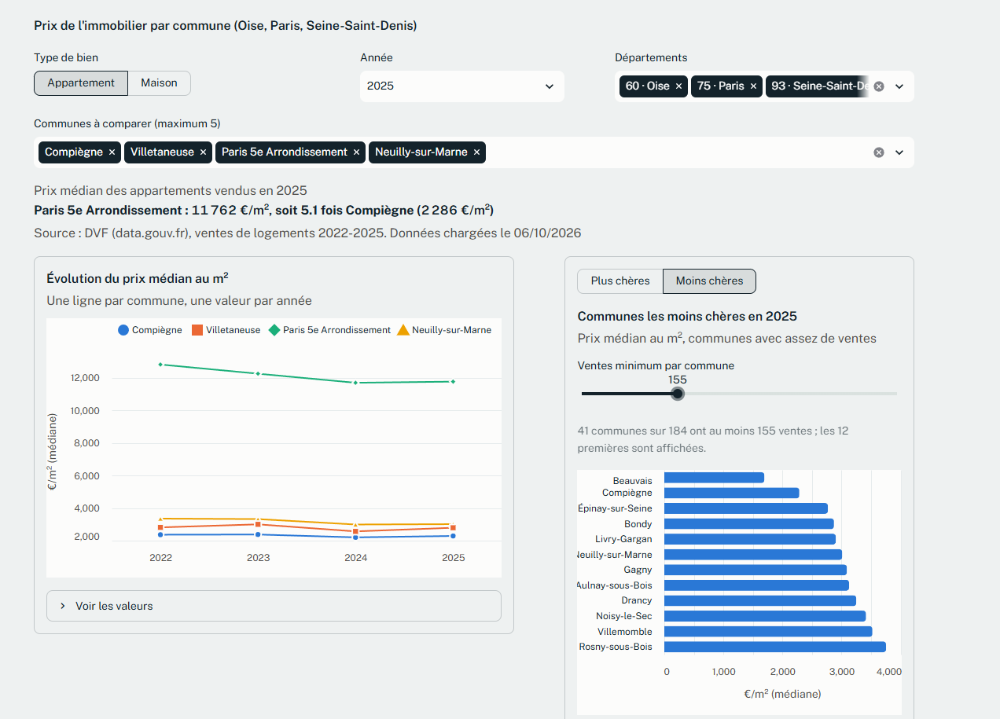
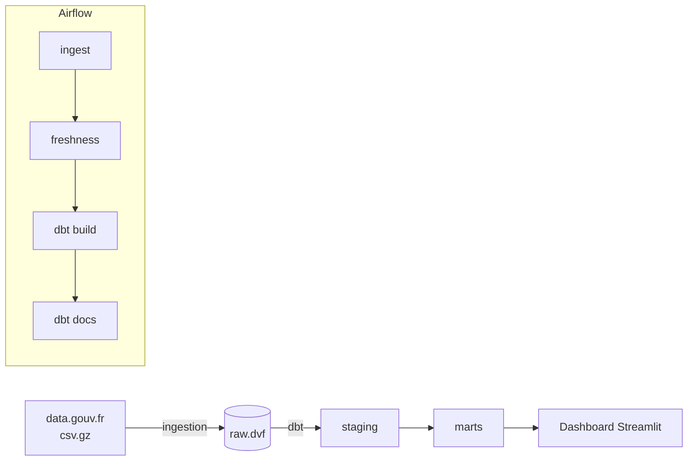
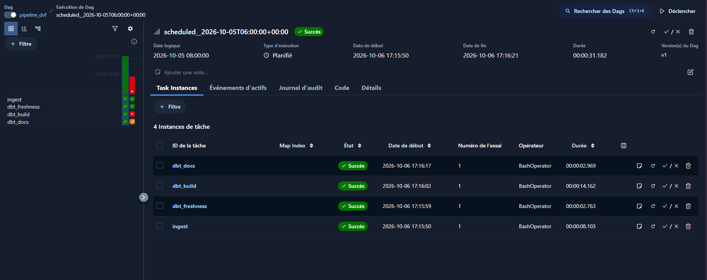
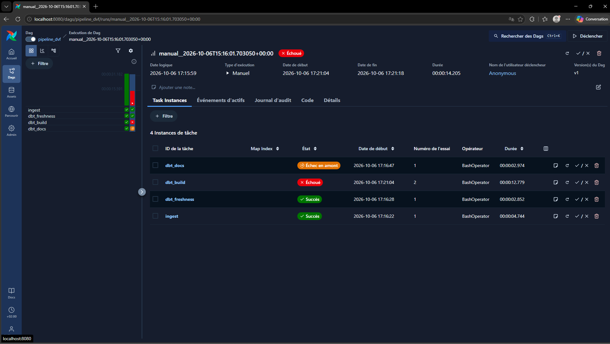
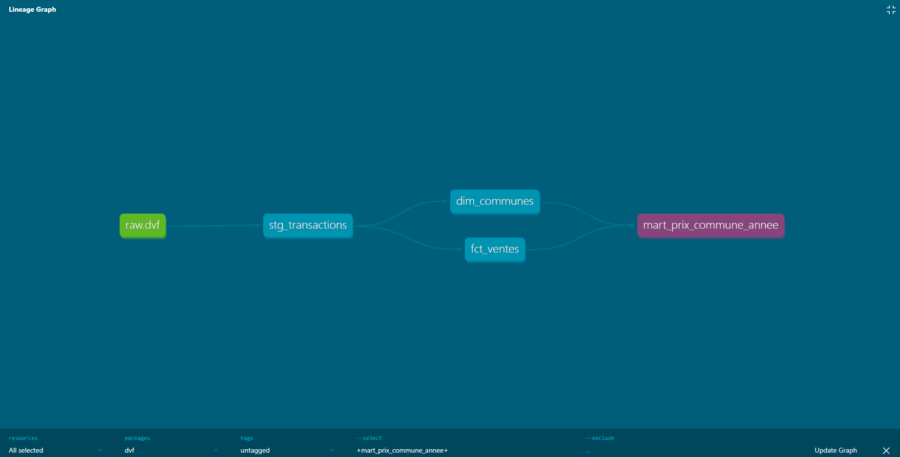

# Pipeline de données immobilières (DVF) : dbt + Airflow

Pipeline complet sur les transactions immobilières publiques (DVF, data.gouv.fr) pour l'Oise, Paris et la Seine-Saint-Denis, 2022-2025 : ingestion dans Postgres, transformations dbt testées, orchestration Airflow, tableau de bord Streamlit. Tout se lance avec une commande.



## Lancer

Prérequis : Docker Desktop.

```bash
docker compose up -d --build
```

| Service | Adresse |
|---|---|
| Airflow | http://localhost:8080 (pas de mot de passe en local) |
| Dashboard | http://localhost:8501 |
| Entrepôt Postgres | localhost:5433, base `dvf`, utilisateur `dvf` |

Premier chargement : dans Airflow, déclenche le DAG `pipeline_dvf` (paramètres par défaut : années 2022-2025, départements 60, 75, 93). Il tourne ensuite tout seul chaque lundi à 6 h.

## Architecture



Détail des couches et des règles métier : [docs/architecture.md](docs/architecture.md).



## Qualité des données

18 tests dbt s'exécutent à chaque run. Si un test échoue, `dbt build` saute les modèles en aval : le mart lu par le dashboard n'est pas mis à jour avec des données douteuses.

Démonstration sur un vrai cas : je tronque à 80 % le fichier de la Seine-Saint-Denis 2025. Le test de volume échoue, le mart garde ses 11 897 ventes, et la tâche `dbt_build` passe en rouge dans Airflow. Journal complet : [docs/demo_test_casse.log](docs/demo_test_casse.log), reproductible avec `scripts/demo_test_casse.ps1`.



Documentation des modèles et lignage : `dbt docs generate` (généré à chaque run par le DAG).



## Mesures

| Mesure | Valeur |
|---|---|
| Lignes brutes chargées (3 départements, 4 ans) | 708 740 |
| Lignes après dédoublonnage (staging) | 622 559 (86 181 doublons exacts, 12,2 %) |
| Ventes de logements retenues (`fct_ventes`) | 197 577 |
| Lignes du mart prix par commune et année | 3 416 |
| Modèles dbt / tests dbt | 4 / 18 |
| Durée d'un run complet du DAG (fichiers déjà téléchargés) | 27 à 31 s |

Leçon de performance : sur des tables fraîchement créées, Postgres n'a pas de statistiques. `fct_ventes` dépassait 3 minutes ; un `ANALYZE` en post-hook dbt et un index sur `id_mutation` l'amènent à 1 à 3 s.

## Choix et limites

- Une mutation est une vente : `valeur_fonciere` est répétée sur chaque ligne, elle n'est jamais additionnée.
- Sont retenues les ventes d'un seul logement (maison ou appartement), sans local commercial, avec un prix entre 300 et 40 000 €/m². Ce sont des choix documentés et paramétrables (variables dbt), pas la vérité du marché.
- La couche brute est en texte : un changement de format de la source casse l'ingestion (en-tête vérifié), pas les transformations en silence.
- `fct_ventes` est reconstruite avant son test : seul le mart est protégé d'un chargement défectueux.

## Développement

```bash
pip install -r requirements-dev.txt
pytest tests
```

La CI GitHub Actions lance `docker compose config`, les tests unitaires, charge un vrai fichier (Seine-Saint-Denis 2025) et exécute `dbt build` sur un Postgres de service.

Source des données : DVF, data.gouv.fr, Licence Ouverte 2.0.
