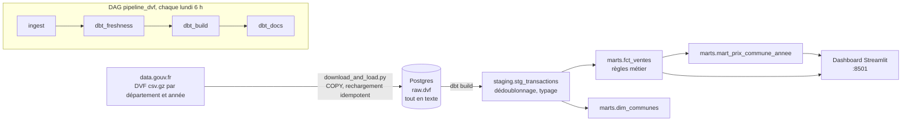

# Architecture

## Couches

| Couche | Contenu | Pourquoi |
|---|---|---|
| `raw.dvf` | Fichiers tels quels, colonnes en texte, + `_source_file`, `_loaded_at` | Rien n'est perdu ; recharger un fichier remplace uniquement ses lignes |
| `staging.stg_transactions` | Doublons exacts retirés, types convertis | Une seule définition d'une ligne propre |
| `marts.fct_ventes` | Une ligne par vente de logement exploitable | Règles métier au même endroit |
| `marts.mart_prix_commune_annee` | Prix médian au m² par commune, année et type de bien | Ce que lit le dashboard |

## Règles métier (fct_ventes)

- Une mutation est une vente ; `valeur_fonciere` est répétée sur chaque ligne de la mutation, elle n'est jamais additionnée.
- Seules les ventes d'un seul logement (maison ou appartement), sans local commercial, sont gardées.
- Prix au m² entre 300 et 40 000 € (variables dbt `prix_m2_min` / `prix_m2_max`, utilisées par le modèle **et** par son test).

## Qualité des données

- 18 tests dbt : non-nuls, unicité, valeurs acceptées, relations, plage de prix (`prix_m2_plausible`), volume par département et année.
- Le test de volume échoue si un département-année tombe sous 50 % de sa médiane (fichier tronqué). `dbt build` saute alors les modèles en aval : le mart n'est pas mis à jour. Démonstration : `docs/demo_test_casse.log`.
- Fraîcheur de la source : alerte à 7 jours, échec à 30 jours.

## Limites connues

- `fct_ventes` est reconstruite avant son test ; seul le mart est protégé d'un chargement défectueux.
- Les règles de sélection (un seul logement, pas de local commercial, plage de prix) sont des choix documentés, pas la vérité du marché.
